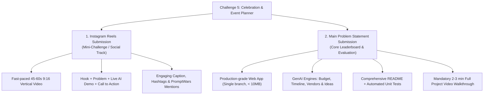
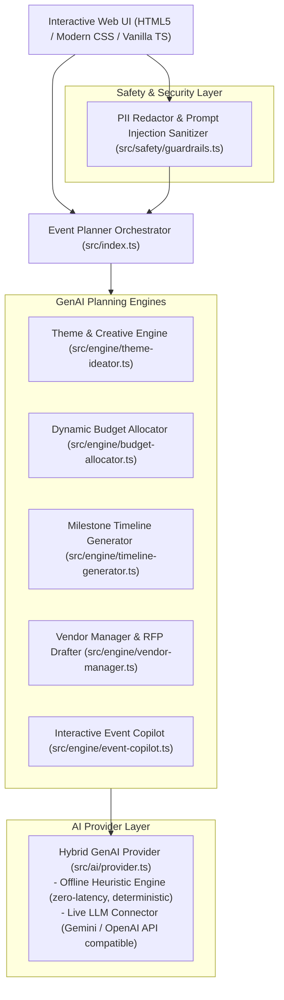

# Implementation Plan: GenAI Celebration & Event Planner (CelebraTech AI)

**Challenge:** [Challenge 5] Celebration & Event Planner  
**Repository:** [https://github.com/ujju2020/Celebration_Event-Planner.git](https://github.com/ujju2020/Celebration_Event-Planner.git)  
**Developer:** Ujjwal Kumar Bhowmick  
**Email:** ujjwalkumarbhowmick30@gmail.com  
**Copyright:** (c) 2026 Ujjwal Kumar Bhowmick. All rights reserved.  

---

## 1. Executive Summary & Challenge Objectives

The goal is to engineer a production-ready, highly intuitive **GenAI-powered Celebration & Event Planning Assistant** (**CelebraTech AI**) that empowers users to seamlessly plan and manage:
1. **Weddings** (Ceremonies, guest hospitality, catering, rituals, entertainment, photography)
2. **Milestone Birthdays** (Themed decor, surprise reveals, music/performances, cake & dining)
3. **Community & Corporate Events** (Festivals, galas, charity drives, volunteer coordination, logistics)

The platform provides intelligent, dynamic budgeting, comprehensive timeline scheduling, vendor checklists with negotiation support, personalized thematic and content generation (speeches, invites, itineraries), and an interactive context-aware AI copilot.

---

## 2. Dual Submission Strategy

To maximize results, the project is structured to address both submission requirements:

### Track 1: Challenge 5 – Instagram Reels Mini-Challenge
* **Format:** Vertical video (9:16 ratio, 1080x1920), 45–60 seconds duration.
* **Storyline:**
  * **0:00 - 0:06 (The Hook):** Show the real-world chaos of spreadsheets, budget overshoots, and forgotten vendor tasks.
  * **0:06 - 0:18 (The Reveal):** Launch CelebraTech AI, select event vertical (e.g. Wedding, ₹12 Lakhs / $25,000 budget, 150 guests) and click one-click generate.
  * **0:18 - 0:32 (Core Features):** Demonstrate dynamic budget breakdown with auto-allocated contingency buffer and month-to-month countdown timeline.
  * **0:32 - 0:44 (GenAI Magic):** Showcase personalized theme generator, custom welcome speeches, and vendor negotiation prompts.
  * **0:44 - 0:60 (Outro & CTA):** Highlight clean code architecture, repo link, and PromptWars Challenge 5 submission.
* **Deliverable:** Complete scene-by-scene script, text overlays, audio recommendations, caption, and hashtags provided in documentation.

### Track 2: Main Submission for Problem Statement
* **Format:** Public GitHub repository (`https://github.com/ujju2020/Celebration_Event-Planner.git`) on a single `main` branch.
* **Repository Size:** Strictly maintained under 10 MB (clean `.gitignore` excluding `node_modules`, `dist`, `.gemini`, coverage reports).
* **Evaluation Criteria Alignment:**
  * **High Impact:** Deep problem alignment with realistic budgeting logic, adaptive timelines, intelligent vendor checklists, and creative GenAI generation.
  * **Medium Impact:** Solid architecture, automated Vitest unit test suite (>90% code coverage), and rigorous security/guardrail layers (PII masking, prompt injection protection, input sanitization).
  * **Low Impact:** Polished UI design, WCAG 2.1 AA accessibility (high contrast, keyboard navigation, aria labels), dark/light theme, and printable dossier export.
* **Mandatory Walkthrough Video:** 2-3 minute comprehensive demonstration showing live workflow, tests passing, architectural breakdown, and real-world utility.

---

## 3. System Architecture & Core Modules

### Module Specifications

1. **`src/types/index.ts`**:
   - Strongly typed domain definitions for `EventType` (`wedding`, `birthday`, `community`), `BudgetBreakdown`, `BudgetItem`, `MilestoneTimeline`, `TimelinePhase`, `VendorChecklist`, `VendorCategory`, `ThematicConcept`, `CopilotMessage`, and `PlannerDossier`.

2. **`src/safety/guardrails.ts`**:
   - PII detection and redaction (phone numbers, emails, credit card data, Aadhaar / SSN formats).
   - Prompt injection defense (sanitizing malicious inputs attempting system overrides).
   - Numerical boundary sanitization (enforcing non-negative budgets, realistic guest counts, valid date horizons).

3. **`src/engine/budget-allocator.ts`**:
   - Algorithmic budget distribution based on industry benchmarks for Weddings, Birthdays, and Community events.
   - Dynamic contingency fund allocation (typically 10-15%).
   - Cost-per-guest calculations and dynamic rebalancing when guest count or tier changes.
   - Overspend warning triggers and cost-cutting recommendations.

4. **`src/engine/timeline-generator.ts`**:
   - Phase-based milestone scheduling (T-6 Months, T-3 Months, T-1 Month, T-1 Week, T-1 Day).
   - Granular Day-of "Run of Show" hour-by-hour schedule generator.
   - Critical path task identification with dependency checks.

5. **`src/engine/vendor-manager.ts`**:
   - Category-specific vendor checklists (Venue, Catering, Photography, Decor, AV & Entertainment, Logistics, Legal/Permits).
   - Automated RFP (Request for Proposal) drafting generator.
   - Crucial interview questions and contract safety red flags for each vendor type.

6. **`src/engine/theme-ideator.ts`**:
   - Context-driven creative theme generator tailored to event type, cultural context, and vibe.
   - Color palettes, decor ideas, dress codes, invitation card copy, and customized toast/speech drafts.

7. **`src/engine/event-copilot.ts`**:
   - Context-aware chat assistant that interprets user change requests (e.g., *"Guest list grew by 50 people"*, *"Need to reduce photography cost by 20%"*) and recalculates budgets and timeline tasks dynamically.

8. **`src/ai/provider.ts`**:
   - Pluggable provider architecture supporting offline heuristic rule-based execution (for deterministic, zero-network, ultra-fast local testing and demos) and optional live API integration (Gemini / OpenAI).

9. **`src/ui/` & `index.html`**:
   - Modern, responsive, high-contrast dashboard with tabs:
     - 📋 Event Setup & Overview
     - 💰 Dynamic Budget & Optimizer
     - ⏱️ Milestone Timeline & Run of Show
     - 🤝 Vendor Checklist & Negotiation Hub
     - 🎨 GenAI Theme & Speech Studio
     - 💬 Live AI Copilot Assistant
     - 📄 One-click Print/PDF Dossier Export
   - Pre-loaded one-click presets: *Grand Indian Wedding*, *30th Milestone Retro Birthday*, *City Cultural Food Fest*.

---

## 4. Quality, Testing & Compliance Plan

* **Automated Unit Testing with Vitest:**
  - `tests/guardrails.test.ts`: Validate PII masking and prompt injection shields.
  - `tests/budget-allocator.test.ts`: Validate exact percentage splits, contingency reserving, and recalculation formulas.
  - `tests/timeline-generator.test.ts`: Validate timeline phase date offsets and Day-of schedule generation.
  - `tests/vendor-manager.test.ts`: Validate RFP generation and questionnaire completeness.
  - `tests/theme-ideator.test.ts`: Validate theme generation and personalized speech copy.
  - `tests/event-copilot.test.ts`: Validate state mutation and query response behavior.
* **Target Coverage:** >90% code coverage across all business logic modules.
* **Repository Discipline:**
  - Keep Git tree on a single branch (`main`).
  - Keep repository size strictly under 10 MB via explicit `.gitignore`.
  - Maintain documentation with licensing and developer details.

---

## 5. Implementation Roadmap & Steps

1. **Setup Core Project Configs:**
   - Create `.gitignore`, `package.json`, `tsconfig.json`, `vitest.config.ts`.
2. **Implement Core Engine Modules:**
   - Define types in `src/types/index.ts`.
   - Implement `src/safety/guardrails.ts`.
   - Implement `src/engine/budget-allocator.ts`.
   - Implement `src/engine/timeline-generator.ts`.
   - Implement `src/engine/vendor-manager.ts`.
   - Implement `src/engine/theme-ideator.ts`.
   - Implement `src/engine/event-copilot.ts`.
   - Implement `src/ai/provider.ts`.
   - Implement master orchestrator in `src/index.ts`.
3. **Build Comprehensive Test Suite:**
   - Write and execute Vitest suites for all engines and guardrails.
4. **Develop Sleek, Interactive Web Application:**
   - Build `index.html` with responsive styles in `src/ui/style.css` and event binding in `src/ui/app.ts`.
   - Support zero-build immediate browser previewing.
5. **Prepare Dual Submission Deliverables:**
   - Update `README.md` with complete architecture, vertical specifications, setup guides, and evaluation checklist.
   - Create `InstagramReelGuide.md` with full 60-second video script, scene-by-scene storyboard, and caption.
   - Create `VideoSubmissionGuide.md` with the 2-3 minute comprehensive project walkthrough video script.
6. **Verify, Commit & Push:**
   - Run tests, check repo size, verify single branch `main`, and push cleanly to GitHub remote.
