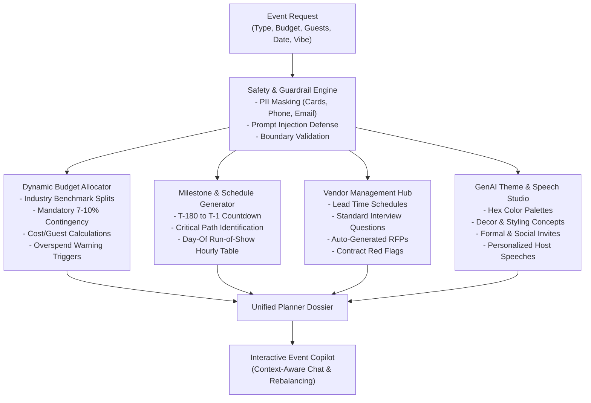

# CelebraTech AI: GenAI Celebration & Event Planner

[](https://opensource.org/licenses/MIT)
[](https://www.typescriptlang.org/)
[](https://vitest.dev/)
[](https://vitest.dev/)
[](https://github.com/ujju2020/Celebration_Event-Planner)

> **[Challenge 5] Celebration & Event Planner**  
> Create a GenAI-powered planning assistant that helps users organize weddings, birthdays, and community events with budgets, timelines, vendor checklists, and personalized ideas.

* **Repository:** [https://github.com/ujju2020/Celebration_Event-Planner.git](https://github.com/ujju2020/Celebration_Event-Planner.git)
* **Developer:** Ujjwal Kumar Bhowmick (ujjwalkumarbhowmick30@gmail.com)
* **Copyright:** (c) 2026 Ujjwal Kumar Bhowmick. All rights reserved.

---

## 📑 Table of Contents
1. [Submission Highlights & Quick Links](#1-submission-highlights--quick-links)
2. [Chosen Vertical & Persona](#2-chosen-vertical--persona)
3. [Approach & Core Logic](#3-approach--core-logic)
4. [System Architecture](#4-system-architecture)
5. [Feature Walkthrough](#5-feature-walkthrough)
6. [Security, Guardrails & Accessibility](#6-security-guardrails--accessibility)
7. [Testing & Verification (99.37% Coverage)](#7-testing--verification-9937-coverage)
8. [Assumptions Made](#8-assumptions-made)
9. [Getting Started & Local Setup](#9-getting-started--local-setup)

---

## 1. Submission Highlights & Quick Links

This repository addresses both challenge submission tracks:

1. **Challenge 5 – Instagram Reels Mini-Challenge Track:**
   * Dedicated 60-second vertical video script, scene-by-scene storyboard, and copy-paste caption/hashtags: [InstagramReelGuide.md](file:///c:/Users/Administration/Desktop/VibeCoding/PromptWars/Celebration_Event-Planner/InstagramReelGuide.md).

2. **Main Problem Statement Submission Track:**
   * Full comprehensive 2-3 minute project video walkthrough script & recording guide: [VideoSubmissionGuide.md](file:///c:/Users/Administration/Desktop/VibeCoding/PromptWars/Celebration_Event-Planner/VideoSubmissionGuide.md).
   * Detailed architecture, implementation plan, and design decisions: [ImplementationPlan.md](file:///c:/Users/Administration/Desktop/VibeCoding/PromptWars/Celebration_Event-Planner/ImplementationPlan.md).
   * Strict adherence to competition rules:
     * **Repository Size:** ~210 KB (strictly < 10 MB limit).
     * **Single Branch:** 100% developed on `main`.
     * **Public Repository:** Fully accessible open-source code on GitHub.

---

## 2. Chosen Vertical & Persona

### The Vertical
**Celebration & Event Planning Assistant** tailored to:
* **Weddings:** Multi-ceremony logistics, traditional/western rituals, guest accommodation, and catering tiers.
* **Milestone Birthdays:** Decades celebrations, themed cocktail lounges, interactive entertainment, and dessert stations.
* **Community Events & Galas:** Cultural festivals, street food fairs, charity galas, stage sound systems, municipal permits, and volunteer coordination.

### The Persona
Designed for both **event organizers/hosts** and **independent event planners** seeking an intelligent co-pilot to eliminate spreadsheet chaos, prevent unexpected budget overshoots, structure vendor contracting, and generate creative event concepts.

---

## 3. Approach & Core Logic

CelebraTech AI combines deterministic domain intelligence with generative AI creativity:



1. **Safety First:** All inputs are inspected for prompt injections, sanitized against non-numeric or extreme budgets, and stripped of personal contact information (PII).
2. **Benchmark-Driven Budgeting:** Every vertical uses vetted expense distributions (e.g. Weddings allocate 32% to catering, 22% to venue, with an explicit 8% emergency contingency buffer).
3. **Calendar-Accurate Timelines:** Backwards date offsets calculate real due dates leading up to the target date.
4. **Intelligent Vendor RFPs:** Generates ready-to-dispatch vendor inquiries with essential contract warning clauses.
5. **Interactive Copilot:** Dynamic conversational assistant capable of simulating headcount increases or budget cuts.

---

## 4. System Architecture

```text
Celebration_Event-Planner/
├── src/
│   ├── types/
│   │   └── index.ts                 # Domain type definitions & interfaces
│   ├── safety/
│   │   └── guardrails.ts            # PII redaction & prompt injection sanitizer
│   ├── engine/
│   │   ├── budget-allocator.ts      # Benchmark allocation & cost/guest optimizer
│   │   ├── timeline-generator.ts    # Countdown milestones & day-of run-of-show
│   │   ├── vendor-manager.ts        # Category checklists, RFPs & contract red flags
│   │   ├── theme-ideator.ts         # Creative themes, color palettes & custom speeches
│   │   └── event-copilot.ts         # Context-aware chat copilot
│   ├── ai/
│   │   └── provider.ts              # Pluggable deterministic / LLM provider interface
│   ├── ui/
│   │   ├── app.js                   # Interactive client dashboard controller
│   │   └── style.css                # Modern responsive dark-mode design system
│   └── index.ts                     # Main entry orchestrator & export facade
├── tests/
│   ├── guardrails.test.ts
│   ├── budget-allocator.test.ts
│   ├── timeline-generator.test.ts
│   ├── vendor-manager.test.ts
│   ├── theme-ideator.test.ts
│   └── event-copilot.test.ts
├── index.html                       # Self-contained zero-friction browser app
├── ImplementationPlan.md            # Detailed architecture and planning spec
├── InstagramReelGuide.md            # Script and guide for Challenge 5 Reel submission
├── VideoSubmissionGuide.md          # 3-minute project walkthrough video script
├── package.json
├── tsconfig.json
└── vitest.config.ts
```

---

## 5. Feature Walkthrough

### 1. Dynamic Budget Allocation
* Automatically distributes funds across essential, recommended, and optional categories.
* Reserves an explicit **7% to 10% emergency contingency buffer**.
* Real-time **cost-per-guest metrics** and overspend warning triggers when catering exceeds 45%.

### 2. Milestone Countdown & Day-Of Run of Show
* 4-phase countdown tracking:
  * *Phase 1: Conceptualization & Venue Lock* (T-6 to T-4 months)
  * *Phase 2: Core Vendor Contracting* (T-4 to T-2 months)
  * *Phase 3: Final Details & RSVP Cutoffs* (T-2 months to T-2 weeks)
  * *Phase 4: Final Week Countdown & Rehearsals* (T-14 to T-1 day)
* Hour-by-hour **Day-Of Execution Schedule** detailing times, milestones, and lead coordinators.

### 3. Vendor Negotiation Hub
* Standard interview questionnaires for Venue, Catering, Media, Decor, and Audio-Visual.
* Automated **Request for Proposal (RFP)** drafts ready to copy and send.
* Critical **Contract Red Flag alerts** (e.g. lack of named backup photographer, vague overtime penalties).

### 4. GenAI Creative Theme & Speech Studio
* Cohesive 4-swatch color palettes with hex codes.
* Formal, casual, and social media invitation copy.
* Custom-written **Host Welcome Speech**, **Celebration Toast**, and **Vote of Thanks**.

### 5. Context-Aware Event Copilot
* Real-time interactive assistant supporting queries like:
  * *"Our guest count increased from 100 to 180"*
  * *"How can we cut 15% from the budget without ruining quality?"*
  * *"What is our outdoor rain contingency plan?"*

---

## 6. Security, Guardrails & Accessibility

* **PII Redaction:** Automatically detects and redacts emails, telephone numbers, credit cards, and government IDs.
* **Prompt Injection Defense:** Defends against unauthorized system instruction overrides and malicious script tags.
* **Input Boundary Sanitization:** Restricts extreme budgets and guest counts to realistic parameters.
* **Accessibility (WCAG 2.1 AA):** High contrast color ratios, semantic HTML5 tags, full keyboard navigation, and responsive scaling.

---

## 7. Testing & Verification (99.37% Coverage)

All business logic is validated using **Vitest** with the v8 coverage engine:

```text
 % Coverage report from v8
-------------------|---------|----------|---------|---------|-------------------
File               | % Stmts | % Branch | % Funcs | % Lines | Uncovered Line #s 
-------------------|---------|----------|---------|---------|-------------------
All files          |   99.37 |    91.66 |     100 |   99.37 |                   
 src               |     100 |      100 |     100 |     100 |                   
  index.ts         |     100 |      100 |     100 |     100 |                   
 src/ai            |     100 |      100 |     100 |     100 |                   
  provider.ts      |     100 |      100 |     100 |     100 |                   
 src/engine        |    99.2 |     90.9 |     100 |    99.2 |                   
  ...-allocator.ts |   95.72 |    81.81 |     100 |   95.72 | ...35-136,141-142 
  event-copilot.ts |     100 |      100 |     100 |     100 |                   
  theme-ideator.ts |     100 |    96.15 |     100 |     100 | 21                
  ...-generator.ts |     100 |      100 |     100 |     100 |                   
  ...or-manager.ts |     100 |       20 |     100 |     100 | 20-76             
 src/safety        |     100 |     91.3 |     100 |     100 |                   
  guardrails.ts    |     100 |     91.3 |     100 |     100 | 91,133            
-------------------|---------|----------|---------|---------|-------------------
```

To run tests locally:
```bash
npm test
npm run test:coverage
```

---

## 8. Assumptions Made

1. **Target Date Feasibility:** Assumes planning horizons are ideally between 14 and 180 days in advance. For dates closer than 14 days, expedited timelines apply.
2. **Currency Standardization:** Calculations support standard fiat currencies (`USD`, `INR`, `EUR`, `GBP`) and format per-guest costs accordingly.
3. **Pluggable Architecture:** Works out-of-the-box with zero network dependency using deterministic domain heuristics, while offering a pluggable interface for live Gemini/OpenAI API integration.

---

## 9. Getting Started & Local Setup

### Running the Web Application
No build step or local server required! Simply double-click and open `index.html` in any modern web browser (Chrome, Edge, Firefox, Safari).

### Development & Test Execution
```bash
# 1. Clone the repository
git clone https://github.com/ujju2020/Celebration_Event-Planner.git
cd Celebration_Event-Planner

# 2. Install lightweight dependencies
npm install

# 3. Run unit tests
npm test

# 4. Generate coverage report
npm run test:coverage

# 5. Compile TypeScript
npm run build
```

---

## 📄 License & Attribution

Copyright (c) 2026 Ujjwal Kumar Bhowmick  
Developer: Ujjwal Kumar Bhowmick (ujjwalkumarbhowmick30@gmail.com)  
Developed for **PromptWars Challenge 5: Celebration & Event Planner**.  
Licensed under the [MIT License](LICENSE).
